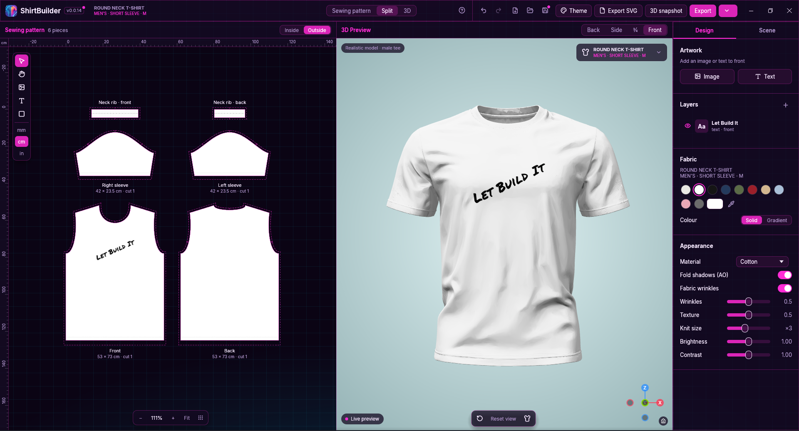
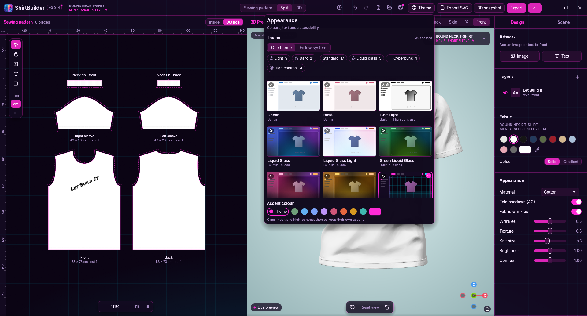
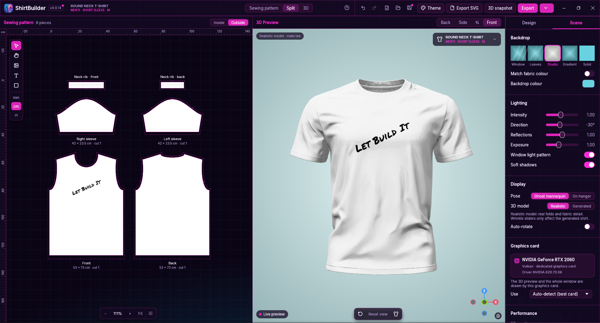

# ShirtBuilder

Design T-shirts on the real sewing pattern and see them on a 3D shirt as you go. Place text and
images on the flat pieces — front, back, sleeves, neck rib — and the 3D preview shows the print
exactly where it will land, including artwork that runs across a seam. When you're done, export
true-scale print and cut sheets.



## Features

- **Garments:** round-neck and V-neck T-shirts, polo shirts and collar shirts, short or long sleeve, men's and
  women's fit, sizes XS–XXL, with seam and hem allowances, notches and grain lines.
- **Artwork:** text in eight fonts (bold, italic, alignment, spacing) and images (PNG, JPEG, WebP, GIF,
  SVG). Drag to move, corners to resize, the knob to rotate; prints can cross onto the next piece.
- **Fabric:** colours and gradients, cotton / jersey / polyester / linen / fleece looks, adjustable wrinkles
  and knit texture.
- **3D preview** on your graphics card: realistic T-shirt models or a generated shirt for every style,
  on a ghost mannequin or a hanger, with studio lighting, soft shadows and several backdrops.
- **Exports:** print sheets (PNG, 100 / 150 dpi, outside and inside), true-scale print & cut SVGs,
  cut lines only, and a 2000 px snapshot of the 3D view.
- **Design files:** New, Open and Save (`.sb` files, images included); unsaved changes are never
  thrown away without asking, and everything can be undone.
- 30 themes, a custom title bar, and a layout that adapts down to small windows.

## Screenshots

**Themes** — 30 built-in themes (standard, Liquid Glass, Cyberpunk and high contrast), filtered by light or dark,
with your own accent colour:



**Scene** — backdrops, studio lighting, ghost mannequin or hanger, the realistic or the generated 3D model, and the
graphics card that draws the preview:



## Download

Get the AppImage from the [latest release](https://github.com/BR1ZB3AR/ShirtBuilder/releases/latest),
then make it executable and run it:

```sh
chmod +x ShirtBuilder-*-x86_64.AppImage
./ShirtBuilder-*-x86_64.AppImage
```

It runs on 64-bit Linux with glibc 2.35 or newer (Ubuntu 22.04+, Debian 12+, Fedora 36+, Linux Mint 21+,
Arch and similar). The 3D preview uses Vulkan or OpenGL from your graphics driver; Open and Save use
your desktop's file dialogs (xdg-desktop-portal, standard on KDE and GNOME).

## Build from source

You need a recent stable Rust toolchain ([rustup](https://rustup.rs)); no other development libraries.

```sh
git clone https://github.com/BR1ZB3AR/ShirtBuilder.git
cd ShirtBuilder
cargo run --release -p shirtbuilder
```

To put it in your app launcher (it builds a release, installs it to `~/.local/bin`, and registers
`.sb` files so they open with a double-click):

```sh
./packaging/install-desktop.sh              # --uninstall removes it again
```

To build an AppImage yourself:

```sh
./packaging/build-appimage.sh               # → target/appimage/ShirtBuilder-<version>-x86_64.AppImage
```

The script downloads the official [appimagetool](https://github.com/AppImage/appimagetool) and AppImage
runtime once. An AppImage needs at least the glibc version of the system it was built on; release
builds are made in Ubuntu 22.04 by [the release workflow](.github/workflows/release.yml).

## Using it

- **Artwork › Text / Image** adds artwork to the selected piece; type the words in the **Text** box.
- On the pattern, drag artwork to move it, a corner to resize, the round knob to rotate
  (Shift: free resize, 15° steps; Alt: no snapping to the centre line).
- **Inside / Outside** switches between the two sides of the fabric (labels, inside prints).
- **Scene** sets the backdrop, lighting, pose, 3D model and quality, and shows which graphics card is used.
- Press **?** in the top bar for all keyboard shortcuts.

## Project layout

| crate | what it does |
|---|---|
| [`crates/sb-core`](crates/sb-core) | garment patterns, cutting lines, notches and seams; the design model and `.sb` files; undo/redo; the 3D shirt meshes — plain Rust, no UI |
| [`crates/sb-print`](crates/sb-print) | the print renderer (tiny-skia, rustybuzz, resvg): fabric, text and images, print atlases, export sheets |
| [`crates/shirtbuilder`](crates/shirtbuilder) | the app (egui + wgpu): top bar, sewing-pattern view, 3D preview, design and scene panels |

The app also builds for the web (WebAssembly, with [trunk](https://trunkrs.dev): `cd crates/shirtbuilder && trunk serve`);
that build is experimental.

## Tests

```sh
cargo test --workspace
# renders the real app on the GPU and saves screenshots:
SB_SCREENSHOT_DIR=/tmp/sb cargo test -p shirtbuilder --test screenshots -- --ignored
```

The tests check the pattern geometry and 3D meshes against reference data, `.sb` files, and the
interface itself: they click buttons, drag artwork and resize the window like a user would.

## License

ShirtBuilder is released under the [MIT License](LICENSE).

The bundled fonts — Anton, Bangers, Bebas Neue, Inter, Pacifico, Permanent Marker, Playfair Display and
Space Grotesk — are licensed under the SIL Open Font License 1.1; see
[`crates/shirtbuilder/assets/fonts`](crates/shirtbuilder/assets/fonts).
